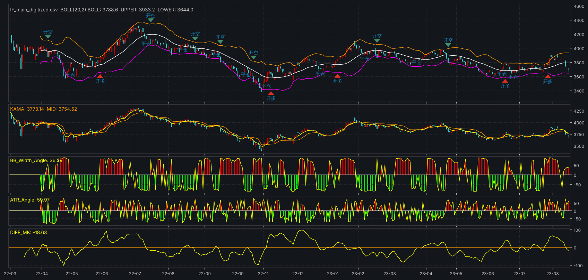

# 趋势跟踪信号：BOLL + KAMA 动量 + 波动率角度

截图里的 开多 / 开空 / 平仓 信号可以用代码实现。这个仓库把截图上的每个指标和信号规则反推了出来，
用 Python 实现，另有 **通达信** 和 **文华财经** 公式版本（见 [formulas/](formulas/README.md)），
三个版本的信号逐K线一致。在从截图读出的行情数据上做了验证：

- 截图上的 20 个信号，复现出 **18 个**（日期误差不超过 ±1 根K线）
- 2022-04 ~ 2023-06 期间，**95.2%** 的K线上持仓方向（多/空/空仓）与截图一致



## 指标（三类因子）

| 截图名称 | 定义 | 因子 |
|---|---|---|
| BOLL(20,2) | 中轨 = MA(C,20)，上下轨 = 中轨 ± 2×STD(C,20)（样本标准差） | 趋势 |
| KAMA | Kaufman 自适应均线 KAMA(10,2,30) | 趋势/动量 |
| MID | EMA(C,5) | 动量 |
| DIFF_MK | MID − KAMA | 动量 |
| BB_Width_Angle | ATAN((W/REF(W,1) − 1)×100) 转角度，W = (上轨−下轨)/中轨 | 波动率 |
| ATR_Angle | ATAN(ATR − REF(ATR,1)) 转角度，ATR = MA(TR,20) | 波动率 |

这些定义是从截图像素读数推出来的，并用表头数值核对过（2022-07-08 那根K线）：

| | 截图表头 | 本实现 |
|---|---|---|
| BOLL / UPPER / LOWER | 4168.7 / 4368.9 / 3968.6 | 4171.9 / 4371.4 / 3972.3 |
| MID | 4241.38 | 4244.24 |
| KAMA | 4191.93 | 4202.31（样本缺少 2022-03 之前的预热数据） |
| BB_Width_Angle | −75.29 | −75.44 |
| ATR_Angle | −69.71 | −65.94 |

## 信号规则

信号在收盘时确认，且只在空仓时开仓：

- **开多**：收盘 > BOLL 中轨，DIFF_MK > 0.2×ATR，BB_Width_Angle > 0，ATR_Angle > 0
- **开空**：收盘 < BOLL 中轨，DIFF_MK < −0.2×ATR，BB_Width_Angle > 0，ATR_Angle > 0
- **平仓**（任一条件触发）：
  - BB_Width_Angle < 0 且 ATR_Angle < 0（波动率收敛），并且收盘价反向穿过 KAMA
    （多单：收盘 < KAMA；空单：收盘 > KAMA）
  - 移动止损（吊灯止损）：多单收盘 < 最近 10 根K线最高价 − 2.5×ATR；空单收盘 > 最近 10 根K线最低价 + 2.5×ATR。
    `Params(trail_atr_mult=0)` 可关闭

规则的含义是：趋势（价格在中轨哪一侧）、动量（DIFF_MK 的方向）、波动率（布林带张口且 ATR 放大）
三者共振时进场；波动率收敛、价格又回到 KAMA 另一侧时离场，或者从近期高点（低点）回撤超过 2.5 倍 ATR 时止损。

移动止损对应原作者文章里的“以波动幅度为核心的跟踪最高价的止盈止损”。
这里用“最近 10 根K线”的最高价，而不是“开仓以来”的最高价：两种写法在截图上的吻合度一样（都是 18/20），
在随机行情上模拟的 5000 多笔交易里，交易次数、持仓长度也几乎相同；但前者不依赖持仓状态，通达信公式才能算得和 Python 版完全一致。

按截图副图上读出的数值，截图里 10 次开仓全部满足开仓条件；其中 9 次正好落在上次平仓后条件第一次全部满足的那根K线上。
唯一的例外是 2022-05-09：条件已经满足，截图却没有开空。所以开仓规则基本可以确定。
平仓规则是在几种候选规则里，与截图吻合最好的一种，确定性比开仓规则低；
止损倍数 2.5 是在 20 个信号上比较几十种参数后选出来的，有过拟合成分。

## 与截图逐条对比

| 截图 | 本实现 | |
|---|---|---|
| 2022-04-11 开空 | 2022-04-11 开空 | ✓ |
| 2022-04-29 平仓 | 2022-04-29 平仓 | ✓ |
| 2022-05-31 开多 | 2022-05-31 开多 | ✓ |
| 2022-07-08 平仓 | 2022-07-12 平仓 | 晚 2 根 |
| 2022-07-15 开空 | 2022-07-15 开空 | ✓ |
| 2022-08-15 平仓 | 2022-08-12 平仓 | ✓（早 1 根） |
| 2022-08-24 开空 | 2022-08-24 开空 | ✓ |
| — | 2022-09-13 平仓、09-16 开空 | 中途多了一次平仓再开空 |
| 2022-10-13 平仓 | 2022-10-14 平仓 | ✓（晚 1 根） |
| 2022-10-24 开空 | 2022-10-24 开空 | ✓ |
| 2022-11-03 平仓 | 2022-11-03 平仓 | ✓ |
| 2022-11-08 开多 | 2022-11-08 开多 | ✓ |
| 2022-12-20 平仓 | 2022-12-20 平仓 | ✓ |
| 2023-01-05 开多 | 2023-01-06 开多 | ✓（晚 1 根） |
| 2023-02-06 平仓 | 2023-02-03 平仓 | ✓（早 1 根） |
| 2023-02-17 开空 | 2023-02-17 开空 | ✓ |
| 2023-03-24 平仓 | 2023-03-24 平仓 | ✓ |
| 2023-04-24 开空 | 2023-04-24 开空 | ✓ |
| 2023-05-09 平仓 | 2023-05-08 平仓 | ✓（早 1 根） |
| 2023-05-12 开空 | 2023-05-09 开空 | 早 3 根 |
| 2023-06-15 平仓 | 2023-06-14 平仓 | ✓（早 1 根） |
| — | 2023-06-16 开多 … 2023-08-14 开空（共 5 个） | 截图此后没有信号 |

不加移动止损（`trail_atr_mult=0`）时是 16/20、94.9%。
剩下的差异主要来自两点：样本数据是从截图像素读出来的，每根K线有 ±5~10 点误差；
另外原作者的平仓逻辑里可能还有截图上看不出来的条件。

## 使用

```bash
pip install -r requirements.txt

# 用仓库自带的样本（从截图读出的 IF 主力连续，2022-03-04 ~ 2023-08-15）
python -m trend_signals --csv data/IF_main_digitized.csv --plot chart.png

# 用自己的行情 CSV（列名 date/open/high/low/close，或 日期/开盘/最高/最低/收盘）
python -m trend_signals --csv my_data.csv --plot chart.png

# 用 akshare 在线拉取新浪主力连续合约（需 pip install akshare）
# 建议往前多取一段数据给指标预热，再用 --from-date 只看需要的区间
python -m trend_signals --akshare IF0 --start 2021-06-01 --from-date 2022-03-04 --plot chart.png
```

在 Python 里调用：

```python
from trend_signals import load_csv, generate_signals, trades, summary, Params

df = load_csv("data/IF_main_digitized.csv")
sig = generate_signals(df, Params(momentum_atr_mult=0.2))   # 所有参数都可调
print(sig[sig["signal"] != ""][["close", "signal"]])
tr = trades(sig)
print(summary(tr, multiplier=300))                           # IF 每点 300 元
```

`sig` 里包含全部指标列（boll/upper/lower/kama/mid/diff_mk/bb_width_angle/atr/atr_angle）、
`signal`（open_long/open_short/close_long/close_short）和 `position`（1/0/−1）。

### 通达信 / 文华公式

`formulas/` 下有通达信主图公式 + 4 个副图指标，以及文华交易模型 + 4 个辅助指标。
导入方法和注意事项见 [formulas/README.md](formulas/README.md)。

## 注意

- `data/IF_main_digitized.csv` 是从截图上逐根K线读出来的，只用于演示和回归测试，不能拿来做真实回测。
  它的日期是按交易日历推算的（2022-07-08 与截图表头对得上）。
- 截图用的是前复权的主力连续数据。akshare 的新浪主力连续没有复权，换月时会跳空，
  所以价格水平和个别信号会和截图不同。
- 用真实数据时，开始日期前至少留 60 根K线给指标预热；KAMA 的慢速平滑常数记忆很长，预热越长越接近行情软件里的值。
- 信号按收盘价确认，回测也按当根收盘价成交。实盘中应在下一根K线执行，会有滑点。
- 移动止损只按收盘价判断，不是盘中触价止损；跳空时实际亏损会超过 2.5 倍 ATR。
- ATR_Angle 的数值大小取决于品种的点数（ATR 每天变化几个点），规则只用它的正负号，换品种不需要改。
- 截图的 IF 示例只有 13 笔交易，样本太少，不能说明策略有效。上真实资金前，请用全品种、更长的历史数据回测。

## 测试

```bash
python -m pytest -q
```

测试覆盖指标公式、与截图表头数值的核对、与截图信号的吻合度、无未来函数（截断数据后之前的信号不变）、
交易配对和统计，以及通达信 / 文华公式与 Python 版逐K线一致
（用 `tests/formula_interpreter.py` 这个小解释器直接运行 `formulas/` 里的公式文本）。

## 后续规划

在单品种信号之上搭组合层（ETF 趋势过滤风险平价、期货杠杆风险平价 + 趋势 CTA）的原则和实现路径，
见 [docs/plan_A_B.md](docs/plan_A_B.md)。
